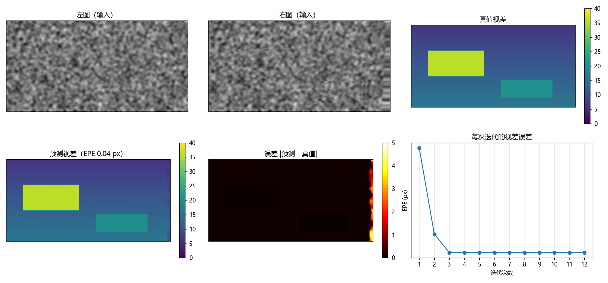
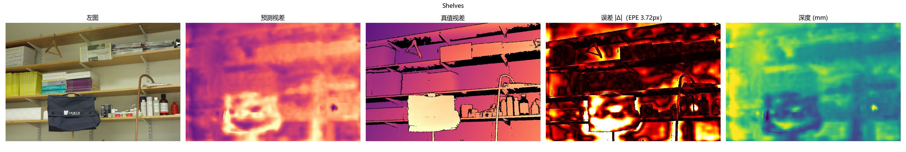
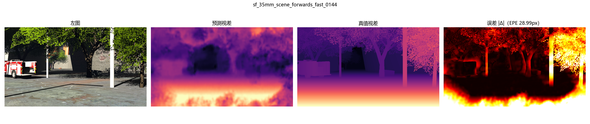

# RAFT-Stereo 学习与最小复现

| 项目 | 内容 |
| :-- | :-- |
| 状态 | ✅ 合成数据跑通 · ✅ Middlebury 真实数据可训练 · ✅ SceneFlow 预训练 + 零样本迁移 |
| 日期 | 2026-11-14 |
| 环境 | conda `nn`（torch 2.7.0 + cu126，RTX 4070） |
| 入口 | `train_overfit.py`（合成）/ `train_real.py`（真实数据）/ `infer.py`（整图推理）/ `eval.py`（整集评测） |
| 论文 | Lahav Lipson, Zachary Teed, Jia Deng. *RAFT-Stereo: Multilevel Recurrent Field Transforms for Stereo Matching*. 3DV 2021（Best Student Paper）· [arXiv:2109.07547](https://arxiv.org/abs/2109.07547) |
| 官方代码 | [princeton-vl/RAFT-Stereo](https://github.com/princeton-vl/RAFT-Stereo) |

## 目的

不调用官方权重，从零写一个能跑通的 RAFT-Stereo，确认自己真的理解了它的四个部件——
**特征网络、相关体、GRU 迭代更新、凸上采样**——并用一对已知真值的合成图验证：
网络能不能靠迭代把视差推到亚像素精度。

## 一、论文读什么

RAFT-Stereo 把光流网络 [RAFT](https://arxiv.org/abs/2003.12039) 搬到双目。迁移的关键差别只有一句：
**光流的位移是二维的，而校正后的双目视差只沿 x 方向**，所以相关体只需要在水平方向搜，
代价从 $O(W^2)$ 降到 $O(D)$，同样的算力就能做分辨率更高、范围更宽的匹配。

四个部件（对应论文 Fig. 2）：

**1. 特征网络（feature / context net）**
左右图各过一个共享权重的编码器，得到 1/4 分辨率特征 $f_1, f_2$；左图再单独过 context net 得到 GRU 的初始隐状态 $h_0$。
用 InstanceNorm 而不是 BatchNorm——训练时 batch 很小，BN 的统计量不稳。

**2. 相关体（correlation volume）**
只沿视差方向做全对相关：

$$
C[i, d, y, x] = \frac{1}{\sqrt{C}} \sum_{c} f_1[c, y, x] \cdot f_2[c, y, x - d], \quad d \in [-D, D]
$$

形状 $[2D+1, H, W]$。为了让感受野更大，论文再沿视差轴做平均池化得到几级金字塔（每级范围翻倍、步长翻倍），
查表时用双线性插值取连续视差处的值——这样网络能"看到"比当前视差范围更远的候选。

**3. 迭代更新（核心，也是论文的主要贡献）**
每次迭代：

$$
h_{k+1} = \mathrm{GRU}\big(h_k,\ \text{Encoder}(C[\cdot, d_k + \Delta])\big), \qquad
d_{k+1} = d_k + \sum_{i} p_i \cdot o_i
$$

- 只在当前视差 $d_k$ 附近取 9 个点（$d_k - 4 \ldots d_k + 4$）的相关特征，而不是全网搜；
- GRU 是**卷积 GRU**（`ConvGRU`），隐状态保留空间结构，信息能在邻域间传播；
- 输出 $2\times4+1=9$ 个 softmax 权重 $p_i$，对视差偏移 $o_i \in \{-4,\ldots,4\}$ 做**凸组合**，得到连续（亚像素）增量 $\Delta d$。

论文的贡献是 **multi-level GRU**：把 GRU 拆成几级、不同级在不同分辨率 / 不同视差范围上更新，
让大范围运动和细节能同时被修正，比单级 GRU 收敛更快、精度更高。

**4. 凸上采样（convex upsampling）**
1/4 分辨率的视差用左图特征预测一组 3×3 权重，对粗视差邻域做加权求和放大回原图。
比双线性插值锐利得多，能保住物体边缘。

**损失**：每次迭代都监督，$L = \sum_{k} \gamma^{K-k} \| d_k - d^{gt} \|_1$，$\gamma = 0.9$（越晚的迭代权重越大）。

**论文报告的结果**：Middlebury 榜首，1px 误差比当时第二名好 29%；ETH3D two-view 上优于所有已发表方法；
realtime 版本在 1080p 上可实时。

## 二、我的实现

代码三个文件，没有依赖官方仓库：

| 文件 | 内容 |
| :-- | :-- |
| `model/raft_stereo.py` | `FeatureEncoder`、`SepConvGRU`、`corr_volume` / `sample_corr` / `CorrPyramid`、`UpdateBlock`、`ConvexUpsampler`、`RAFTStereo`、`sequence_loss` |
| `synthetic.py` | 造一对有真值的合成双目图（随机纹理 + 斜面 + 两个方块，按视差反向 warp） |
| `train_overfit.py` | 在单对图上过拟合 300 步，打印 EPE / bad-pixel，画 `figures/overfit.png` |
| `data/prepare.py` | 把 Middlebury / KITTI / SceneFlow 的压缩包转成 npz（自己解 `.pfm` / `.pgm` / `calib.txt`，SceneFlow 直接流式读 tar.bz2） |
| `data/fetch_url.py` | 多线程分段下载（SceneFlow 站点按连接限速，单连接 0.2 MB/s） |
| `data/stereo_dataset.py` | 随机裁剪 + 翻转增强的 Dataset，按场景 / 序列切分 |
| `train_real.py` | 在真实数据上训练，余弦学习率，支持分段续训（`--resume --stop_at`） |
| `infer.py` | 整图推理，输出视差图 + 深度图（`Z = fB/(d + doffs)`） |
| `eval.py` | 整个 npz 目录上算 EPE / bad-1px / bad-3px，可只测 train 或 val 切分 |
| `results/*.json` | 每次评测的明细（逐场景 + 逐迭代），文档里的数字都能从这里复算 |

和官方实现的差距（有意为之，为了单卡小图能跑通、代码一眼看得懂）：

| 组件 | 论文 / 官方 | 这里 |
| :-- | :-- | :-- |
| 特征通道 | 128，6 个残差块 | 64，每级 2 个残差块 |
| GRU | multi-level（多级、多分辨率） | 单级单分辨率（`UpdateBlock` 里一层 `SepConvGRU`） |
| 相关体 | 用 `grid_sample` 的 `alt` 实现，可切 `reg_cuda` | Python 循环逐 $d$ 移位相乘，$O(D)$ 次访存，小图够用 |
| 上采样 | 8× 凸上采样 + 1/4 分辨率输出 | 4× 凸上采样 |
| 附加特征 | motion features、context 分层 | 无 |

`CorrPyramid` 沿视差轴做 `avg_pool3d(kernel=(4,1,1))` 得到三级，每级取 ±4 共 9 个点，
所以送进 GRU 的相关特征是 $3 \times 9 = 27$ 通道。

## 三、怎么跑

```bash
conda activate nn
cd experiments/raft-stereo

# 1) 合成图：验证实现对不对，不需要任何数据集
python train_overfit.py --steps 300     # 约 1.5 分钟（4070）

# 2) 真实数据：先把 Middlebury 转成 npz（见 data/README.md）
python -m data.prepare --src F:\datasets\middlebury2014\_download `
    --out F:\datasets\stereo\prepared\middlebury --dataset middlebury --width 768

# 3) 训练 + 整图推理
python train_real.py --data F:\datasets\stereo\prepared\middlebury --steps 1200 --batch 2
python infer.py --npz F:\datasets\stereo\prepared\middlebury\Shelves.npz --weights weight/real.pth

# 4) SceneFlow（Driving，4400 对）：多线程下载 + 转换后训练
python data/fetch_url.py --threads 8 --url <frames.tar> --out F:\datasets\sceneflow\_download\driving__frames_cleanpass_webp.tar
python data/fetch_url.py --threads 8 --url <disparity.tar.bz2> --out F:\datasets\sceneflow\_download\driving__disparity.tar.bz2
python train_real.py --data F:\datasets\stereo\prepared\sceneflow --max_disp 320 `
    --steps 4000 --stop_at 1200 --save weight/sceneflow.pth     # 分段续训：再加 --resume --stop_at 2400

# 5) 整集评测 / 跨数据集零样本评测
python eval.py --data F:\datasets\stereo\prepared\middlebury --weights weight/real.pth --max_disp 128
python eval.py --data F:\datasets\stereo\prepared\middlebury --weights weight/sceneflow.pth --max_disp 320
```

下载地址和每步的说明在 `data/README.md`。

只依赖 `torch` / `numpy` / `matplotlib` / `Pillow`，不需要 opencv。

## 四、结果一：单对合成图过拟合（300 步）

| 指标 | 数值 |
| :-- | :-- |
| 参数量 | 0.84 M |
| 训练耗时 | 300 步 / 94 s |
| loss | 13.37 → 0.10 |
| 最终 EPE | **0.04 px** |
| bad-1px / bad-3px | **0.0% / 0.0%** |

逐次迭代的 EPE：

```
2.5  0.5  0.0  0.0  0.0  0.0  0.0  0.0  0.0  0.0  0.0  0.0
```



这张图是用来验证"实现对不对"的，不是性能指标：单对图、300 步、能背下来就说明
**前向 + 反向 + 序列损失**这条链路是通的。两轮迭代就收敛，是因为每轮迭代的位移上限
是 4 个低分辨率像素 = 16 个原图像素，而这张图的真实视差本来就只在这个量级。

> ⚠️ 这里踩过一个坑：`ConvexUpsampler` 一开始忘了乘上采样倍数，低分辨率视差被当成
> 原图像素直接插值。合成图上看不出问题（背得下来），但在真实数据上 12 轮迭代最多
> 只能移动 48 px，EPE 死死卡在 15 px 左右。乘上 `scale=4` 之后，同样的步数从 15 px
> 降到 5 px 上下——**上采样必须乘 scale**，这是 RAFT 系列里最容易漏的一行。

## 五、结果二：Middlebury 2014 真实数据

| 项 | 设置 |
| :-- | :-- |
| 数据 | Middlebury 2014 的 10 个带 GT 场景，缩到 768 宽（见 `data/README.md`） |
| 划分 | 8 个训练 / 2 个验证（Shelves、Vintage），**按场景切分**，不按裁剪块 |
| 训练 | 192×384 随机裁剪，batch 2，1200 步，AdamW lr 2e-4 余弦退火，max_disp 128 |
| 模型 | `hidden_dim=64`，0.84 M 参数，12 轮迭代 |
| 耗时 | 约 5 分钟（4070） |

验证集上每个迭代步的平均 EPE（像素）：

```
第1轮  第2轮  第3轮  第4轮  第5轮  第6轮 … 第12轮
29.10  16.14   9.60   6.64   5.84   5.72  …  5.67
```

整图推理（不在训练集里）：

| 场景 | EPE | bad-1px | bad-3px |
| :-- | --: | --: | --: |
| Shelves | 3.72 px | 67.0% | 40.0% |
| Vintage | 10.78 px | 81.2% | 59.9% |



怎么看这组数字：

- **结构是对的**：货架层板、近处的书包、背景墙的视差层次都出来了，深度图也跟着分层
  （`Z = fB/(d + doffs)`，Shelves 的 `f=1405 px`、`B=176.5 mm`）。
- **精度不高是必然的**：0.84 M 参数、只有 8 张训练图，而且这一份 `real.pth` 是从零训的、
  没用任何预训练（加了 SceneFlow 预训练的效果见下一节）。论文在
  Middlebury 上是 1–2 px、5 M 参数 + 大规模预训练的结果，这里差一个数量级很正常。
- **迭代的收益很明显**：前 4 轮吃掉绝大部分误差（29 → 6.6），之后每轮只降 0.1 px 左右；
  预测图整体偏平滑、带一点左右位置偏置，是典型的小模型 + 小数据欠拟合。
- **Vintage 明显更差**：它的真实视差到 167.7 px（Shelves 只有 14–52 px），超出 128 的
  `max_disp`、又在 1/4 分辨率上被压缩成 32 个格子，小模型很难在这段区间里分辨。

## 六、结果三：SceneFlow 预训练 + 跨数据集迁移

Middlebury 只有 10 个场景，训到 5.7 px 就到头了；SceneFlow 的 Driving 是 4400 对合成
街景（渲染真值、视差从 0.5 一直到 355 px），正好拿来看"在合成数据上学到的匹配能力，
能不能直接用到真实照片上"。

| 项 | 设置 |
| :-- | :-- |
| 数据 | SceneFlow Driving，4400 对，原图 960×540（裁到 536 对齐 8 的倍数），npz 共 23.2 GB |
| 视差 | 0.5 – 355 px，90% 分位 272 px；`--max_disp 320` 覆盖 99% |
| 划分 | 按**序列**切分：8 个序列里 6 个训练（3300 对）、2 个验证（1100 对，评测均匀取 40 张） |
| 训练 | 192×384 随机裁剪，batch 2，4000 步，AdamW lr 2e-4 余弦退火，0.45 s/步 |
| 模型 | `hidden_dim=64`，0.84 M 参数，12 轮迭代 |
| 耗时 | 约 30 分钟（4070，分三段 `--resume --stop_at` 续训） |

验证集上每个迭代步的平均 EPE（中心裁剪，40 张）：

```
             第1轮  第2轮  第3轮  第4轮  第5轮  第6轮  第7轮  第8轮  第9轮 第10轮 第11轮 第12轮
1200 步      34.60  24.58  18.16  14.22  12.13  11.26  10.87  10.62  10.54  10.49  10.45  10.43
2400 步      34.52  24.23  17.50  13.19  10.71   9.61   9.12   8.86   8.78   8.73   8.69   8.66
4000 步      34.47  24.11  17.33  12.96  10.44   9.27   8.71   8.40   8.31   8.26   8.23   8.21
```

整图（960×540，12 轮）却是 **EPE 23.7 px / bad-1px 80.4% / bad-3px 59.2%**（40 张），
比裁剪上的 8.2 差得多。按真值视差分桶看误差（4 张、12 轮）：

| 视差区间 | EPE | 像素占比 |
| :-- | --: | --: |
| 0–32 px | 2.74 px | 32.3% |
| 32–64 px | 4.01 px | 27.5% |
| 64–96 px | 7.16 px | 8.4% |
| 96–128 px | 3.64 px | 6.0% |
| 128–192 px | 14.21 px | 11.9% |
| 192–256 px | **68.66 px** | 11.9% |
| 256–400 px | **99.84 px** | 1.9% |

原因很直接：每轮迭代最多移动 4 个低分辨率像素 = **16 个原图像素**，12 轮的上限是 192 px，
视差更大的近景（车头、路面）根本追不上。把迭代加到 16 / 24 / 32 轮，整图 EPE 只从
23.7 → 19.8 → 18.5 → 18.4，说明光加迭代救不回来——训练时 192×384 的裁剪窗口里大视差
样本本来就少，模型没学会怎么跳到 200 px 以外。

跨数据集（零样本，都不在各自训练集里）：

| 权重 | 训练数据 | Middlebury 10 场景 EPE | bad-1px | bad-3px |
| :-- | :-- | --: | --: | --: |
| `real.pth` | Middlebury 8 场景，1200 步 | 6.70 px | 65.6% | 38.1% |
| `sceneflow.pth` | SceneFlow 6 序列，4000 步 | **5.80 px** | 68.3% | 38.9% |

反向迁移则是崩的：`real.pth` 在 SceneFlow 验证集上是 **55.86 px / 90.7% / 79.2%**。

怎么看这组数字：

- **合成预训练确实有用**：SceneFlow 训出来的模型，在完全没见过的房间场景上比只用 8 张
  真实图训的模型 EPE 更低（5.80 vs 6.70）——它学到的是"怎么迭代地找匹配"，不是记住场景。
- **但坏像素比例没有降**（bad-1px 68.3% vs 65.6%）：EPE 降低主要是小视差区域变准了，
  Jadeplant（视差到 167 px）、Vintage（到 170 px）这种大视差场景仍被 192 px 的行程上限卡住。
- **真实数据训的模型出不去**：`real.pth` 在 SceneFlow 上 55.9 px，因为它的 `max_disp` 只有
  128、训练数据最大视差 170 px，遇到 300 px 的街景完全失效。数据分布的边界比模型容量更致命。
- **这正好对应论文的多级 GRU**：multi-level GRU 让大视差在 1/16 分辨率上先被拉近，
  再逐级细化，不需要每轮走那么远。



## 七、结论

1. 四个部件都验证过了：相关体只沿视差轴搜、GRU 在隐状态里传播空间信息、softmax 凸组合给出亚像素增量、凸上采样保住边缘。
2. 合成数据能过拟合到 0.04 px，说明前向 + 反向 + 序列损失这条链路是对的；真实数据上能到 5.7 px 量级，说明数据管线（pfm 行序、无效掩码、深度尺度）也是对的。
3. 限制精度的是模型容量、数据分布和迭代行程，不是实现：把上采样倍数这个 bug 修掉，同样的脚本、同样的步数，误差从 15 px 掉到 5.7 px；换 SceneFlow 预训练后 Middlebury 零样本到 5.8 px。
4. 合成图的右侧边缘误差最大——那是遮挡区（右图该像素在左图里看不到），`valid` 掩掉了，真实评测时这类区域本来也不参与打分。

## 八、下一步

- [x] 准备 Middlebury 2014 并转成 npz（`data/prepare.py`，见 `data/README.md`）
- [x] 准备 SceneFlow Driving（4400 对）并做跨数据集评测（`data/fetch_url.py` + `eval.py`）
- [ ] KITTI 2015 还没下完（S3 只有 0.12 MB/s），`--dataset kitti` 已经写好了
- [ ] 下载官方权重跑真实图片，和本实现对比（`bash download_models.sh` 走 Google Drive，需要能过墙）
- [ ] 把 `UpdateBlock` 扩成 multi-level GRU（论文的主要贡献点，也是大视差追不上的正解）
- [ ] 把模型加到 5 M 参数，看 Middlebury 上能压到多少
- [ ] 视差转深度：$Z = \dfrac{f \cdot B}{d - (c_{x1} - c_{x0})}$，$f$ 用像素单位

## 九、参考

- 论文：<https://arxiv.org/abs/2109.07547>
- 官方代码：<https://github.com/princeton-vl/RAFT-Stereo>
- 光流前作 RAFT：<https://arxiv.org/abs/2003.12039>
- 官方代码结构：`demo.py`（推理）、`train_stereo.py`（训练）、`core/`（`raft_stereo.py` 主模型、`corr.py` 相关体、`update.py` GRU + 凸上采样、`extractor.py` 特征网络）
